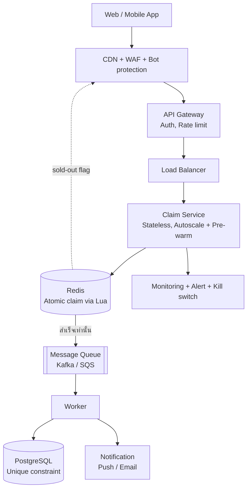

# สถานการณ์ที่ 1: Flash Sale แจกโค้ดส่วนลด 1,000 สิทธิ์

**โจทย์:** เปิดให้กดพร้อมกันเวลา 12:00 น. คาดว่ามีผู้ใช้เข้าพร้อมกันบน Web และ Mobile App ประมาณ 50,000 คนภายใน 5 นาทีแรก

---

## 0. การวิเคราะห์โจทย์ก่อนออกแบบ

| ข้อสังเกต | ผลต่อการออกแบบ |
|---|---|
| 50,000 คน / 5 นาที ≈ 170 request/วินาทีโดยเฉลี่ย แต่ **ในทางปฏิบัติจะกระจุกตัวในไม่กี่วินาทีแรกหลัง 12:00** | ออกแบบตามจุดพีค ไม่ใช่ค่าเฉลี่ย (ควรสมมติพีคสูงกว่าค่าเฉลี่ยหลายสิบเท่า แล้วยืนยันด้วย load test) |
| มีสิทธิ์เพียง 1,000 ส่วนผู้ใช้ 50,000 | ผู้ใช้ราว 98% จะไม่ได้สิทธิ์ ต้อง **ปฏิเสธเร็วและถูกที่สุด ก่อนถึงฐานข้อมูล** |
| แคมเปญแบบนี้เป็นเป้าหมายของบอทและสคริปต์ | ต้องมีการป้องกันบอทและ rate limiting |
| ผู้ใช้มีทั้ง Web และ Mobile | ต้องผ่านจุดเข้า (API Gateway) เดียวกัน และมี client ที่ทำ retry อย่างสุภาพ (backoff) |

**หลักการออกแบบ 3 ข้อ**
1. **ไม่ให้ request ส่วนใหญ่ถึงฐานข้อมูล** ฐานข้อมูลเป็นคอขวดที่ scale ยากที่สุด
2. **ทำการตัดสินสิทธิ์ที่ชั้นที่เร็วและ atomic** (Redis) แล้วค่อยบันทึกถาวรแบบอะซิงโครนัส
3. **มีด่านป้องกันหลายชั้น (defense in depth)** ข้อมูลใน cache อาจหายได้ แต่สิทธิ์ต้องไม่ถูกแจกเกิน

---

## ข้อ 1: High-Level System Architecture



### Component และเหตุผลที่เลือก

| Component | ตัวอย่างเทคโนโลยี | บทบาท / เหตุผล |
|---|---|---|
| **CDN + WAF + Bot protection** | Cloudflare, AWS CloudFront + WAF, reCAPTCHA / Turnstile, Play Integrity / App Attest (มือถือ) | รับ traffic ของหน้าแคมเปญและไฟล์ static ลดภาระเซิร์ฟเวอร์ กรองบอทและสแปมตั้งแต่ขอบระบบ |
| **API Gateway + Rate limiting** | Kong, AWS API Gateway, NGINX | ตรวจ token, จำกัดจำนวน request ต่อ user/IP/device, ตัดคำขอเกินโควตาก่อนเข้าระบบหลัก |
| **Waiting room / Virtual queue** (ทางเลือก) | Queue-it หรือสร้างเอง | ปล่อยผู้ใช้เข้าเป็นระลอก ถ้าพีคสูงเกินความสามารถของระบบ |
| **Load Balancer + Stateless Claim Service** | K8s / ECS + autoscaling | scale แนวนอนได้เพราะไม่เก็บ state ในเครื่อง **ต้อง pre-warm ก่อน 12:00** เพราะ autoscale ตอบสนองไม่ทันพีคสั้น ๆ |
| **Redis (Cluster/Sentinel + replication)** | Redis | เก็บจำนวนสิทธิ์คงเหลือและรายชื่อผู้รับแล้ว ตอบระดับมิลลิวินาที รองรับ atomic operation |
| **Message Queue** | Kafka, SQS, RabbitMQ | รับเฉพาะคำขอที่ **สำเร็จ** แล้วให้ worker เขียน DB ตามความเร็วที่ DB รับไหว (load leveling) |
| **Database** | PostgreSQL + connection pooling (PgBouncer) | เป็น source of truth ของสิทธิ์ที่แจกแล้ว ไม่อยู่บนเส้นทางที่ request ทุกตัวต้องผ่าน |
| **Sold-out flag** | Redis key + cache ที่ขอบ / ใน client | เมื่อสิทธิ์หมด ตอบ "หมดแล้ว" ทันทีโดยไม่ต้องเรียก backend อีก |
| **Observability** | Prometheus/Grafana, APM, Alert | ดูอัตรา request, latency, error, ความยาวคิว และมี **kill switch** ปิดแคมเปญได้ |

### ลำดับการทำงาน (Flow)

1. ก่อน 12:00 โหลดจำนวนสิทธิ์ (1,000) ลง Redis, pre-warm เซิร์ฟเวอร์, เตรียม cache หน้าแคมเปญ
2. เวลา 12:00 (ยึดเวลา **เซิร์ฟเวอร์** เป็นหลัก ไม่เชื่อเวลาในเครื่องผู้ใช้) ผู้ใช้กดรับสิทธิ์ → ผ่าน CDN/WAF → API Gateway (ตรวจสอบตัวตนและ rate limit)
3. Claim Service เรียก Redis Lua script เพื่อ **ตรวจ + หักสิทธิ์ + บันทึกผู้รับ** แบบ atomic
4. ถ้าสำเร็จ → ส่งเข้า Message Queue → Worker บันทึก DB และส่งแจ้งเตือน ถ้าไม่สำเร็จ (หมด/รับแล้ว) → ตอบกลับทันที
5. เมื่อสิทธิ์หมด ตั้ง sold-out flag ให้ขอบระบบตอบ "หมดแล้ว" เอง
6. หลังจบ ทำ reconciliation เทียบจำนวนใน Redis กับ DB

### การจัดการความล้มเหลว (Resilience)

- **Circuit breaker / timeout** ระหว่าง service และ graceful degradation (เช่น ระบบแจ้งเตือนล่าช้าไม่ควรทำให้การแจกสิทธิ์ล้ม)
- **Redis ล่ม/failover**: ใช้ replication + Sentinel/Cluster แต่ยอมรับว่า replication เป็นแบบ asynchronous ข้อมูลล่าสุดอาจหายได้ จึงต้องมี **DB constraint เป็นด่านสุดท้าย**
- **Client retry**: ใช้ exponential backoff + jitter และ idempotency key เพื่อกันการกดซ้ำหรือ retry ที่ทำให้ได้สิทธิ์ซ้ำ
- **Load test** ที่ 2-3 เท่าของพีคที่คาด ก่อนวันจริง และซ้อมแผนปิดแคมเปญ

---

## ข้อ 2: Logic ป้องกัน Race Condition (ไม่ซ้ำ และไม่เกิน 1,000)

### ปัญหา
รูปแบบ **check-then-act** แบบไม่ atomic:

```text
Request A: อ่าน stock = 1
Request B: อ่าน stock = 1     <- อ่านพร้อมกัน
Request A: หัก stock -> 0, ให้สิทธิ์
Request B: หัก stock -> -1, ให้สิทธิ์   <- แจกเกิน!
```

### แนวทาง: ทำให้ "ตรวจ + หัก + บันทึกผู้รับ" เป็นขั้นตอนเดียวที่แบ่งแยกไม่ได้

Redis ประมวลผลคำสั่งทีละตัว และ Lua script ทั้งก้อนถูกรันโดยไม่มีคำสั่งอื่นแทรก

```lua
-- KEYS[1] = stock:{campaign}     จำนวนสิทธิ์คงเหลือ
-- KEYS[2] = claimed:{campaign}   SET ของ userId ที่รับแล้ว
-- ARGV[1] = userId
if redis.call('SISMEMBER', KEYS[2], ARGV[1]) == 1 then
  return -1            -- เคยรับแล้ว (ป้องกันรับซ้ำ)
end
local stock = tonumber(redis.call('GET', KEYS[1]) or '0')
if stock <= 0 then
  return 0             -- สิทธิ์หมดแล้ว
end
redis.call('DECR', KEYS[1])
redis.call('SADD', KEYS[2], ARGV[1])
return 1               -- สำเร็จ
```

**หมายเหตุ:** ถ้าใช้ Redis Cluster ต้องให้ key ที่ใช้ใน script เดียวกันอยู่ใน hash slot เดียวกัน (ใช้ hash tag เช่น `{campaign123}`)

### ป้องกันหลายชั้น

| ชั้น | กลไก | ป้องกันอะไร |
|---|---|---|
| 1 | Redis Lua atomic script | แจกเกินและรับซ้ำในช่วงโหลดสูง (เร็ว) |
| 2 | **Unique constraint ใน DB** `UNIQUE (campaign_id, user_id)` | ผู้ใช้หนึ่งคนได้สิทธิ์ครั้งเดียว แม้ Redis ผิดพลาดหรือข้อมูลหายหลัง failover |
| 3 | **Idempotency key** ต่อคำขอ | กดซ้ำ/retry/ส่งซ้ำจากเครือข่ายไม่ทำให้ได้สิทธิ์เพิ่ม |
| 4 | **ตรวจจำนวนใน DB** ตอนบันทึก เช่น ตรวจว่าจำนวนที่แจกไม่เกิน 1,000 ในธุรกรรมเดียวกัน | ปิดช่องที่ Redis หลุด |
| 5 | **Reconciliation** หลังจบแคมเปญ | ตรวจความถูกต้องและคืนสิทธิ์ที่ตกหล่น |

### ทางเลือกถ้าไม่ใช้ Redis (ใช้ DB อย่างเดียว)

```sql
-- แจกคูปองที่สร้างไว้ล่วงหน้าแบบ atomic โดยไม่ block คำขออื่น
UPDATE coupons
SET claimed_by = :user_id, claimed_at = now()
WHERE id = (
  SELECT id FROM coupons
  WHERE campaign_id = :cid AND claimed_by IS NULL
  ORDER BY id
  FOR UPDATE SKIP LOCKED
  LIMIT 1
)
RETURNING code;
```

ข้อดีคือถูกต้องโดยธรรมชาติ ข้อเสียคือรับโหลดพีคได้น้อยกว่า Redis มาก จึงเหมาะเป็นตัวสำรองหรือเมื่อจำนวนผู้ใช้ไม่สูงนัก

---

## ข้อควรระวัง / การแลกเปลี่ยน (Trade-offs)

- **ความเป็นธรรม**: การตอบ "หมดแล้ว" เร็วดีต่อระบบ แต่ถ้าธุรกิจต้องการความยุติธรรมมากกว่า อาจใช้ระบบสุ่มจากผู้เข้าร่วม (lottery) แทน "ใครกดเร็วได้ก่อน" ซึ่งลดภาระระบบและลดแรงจูงใจของบอท (เป็นการตัดสินใจร่วมกับทีม Business)
- **Redis ไม่ใช่แหล่งความจริงสุดท้าย** ต้องมี DB constraint เสมอ
- **ตัวเลขในเอกสารเป็นสมมติฐาน** ต้องยืนยันด้วย load test กับสภาพแวดล้อมจริง และปรับตามข้อจำกัดจริง เช่น งบ ผู้ให้บริการคลาวด์ stack เดิมของบริษัท
