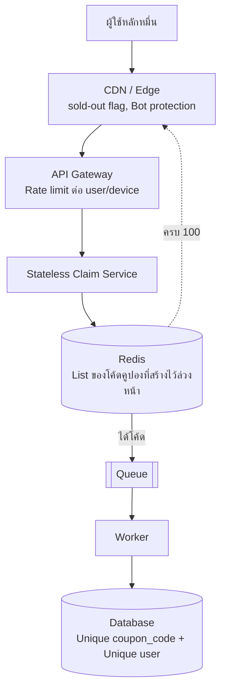

# สถานการณ์ที่ 3: แจกคูปอง 100 สิทธิ์ ผู้ใช้กดพร้อมกันหลักหมื่นคน

**โจทย์:** ผู้ใช้กดเข้ามาพร้อมกันหลักหมื่นคนเวลา 12:00 น. ออกแบบ Architecture และ Logic เพื่อไม่ให้ Database ล่ม และป้องกันการแจกคูปองเกิน (Overbooking)

> **หมายเหตุ:** สถานการณ์นี้คล้ายสถานการณ์ที่ 1 มาก ดูรายละเอียดของส่วนประกอบพื้นฐาน (CDN, Gateway, Redis, Queue, Observability) ได้ใน [`01-scenario-1-flash-sale.md`](./01-scenario-1-flash-sale.md) เอกสารนี้เน้น **ส่วนที่ต่างกันและเข้มข้นขึ้น** เพราะสิทธิ์มีเพียง 100 ในขณะที่ผู้กดมีหลักหมื่น (อัตราไม่ได้สิทธิ์สูงกว่า 99%)

---

## 1. หลักการออกแบบ

1. **ไม่ให้ request ส่วนใหญ่ถึง Database เลย** ผู้ใช้เกือบทั้งหมดจะไม่ได้สิทธิ์ จึงต้องตอบ "หมดแล้ว" ที่ชั้นหน้าสุด
2. **แจกสิทธิ์ผ่านกลไก atomic** ที่ไม่มีทางแจกเกินโดยโครงสร้าง ไม่ใช่โดยการ "ตรวจแล้วหวังว่าไม่ชนกัน"
3. **DB รับแค่ 100 รายการ** ซึ่งเบามาก จึงไม่ใช่คอขวดอีกต่อไป

## 2. Architecture (ย่อ)



## 3. Logic ป้องกัน Overbooking

### 3.1 สร้างโค้ดคูปอง 100 ใบล่วงหน้า แล้วให้ Redis แจกทีละใบ
- ก่อนเปิดแคมเปญ สร้างโค้ด 100 ใบ (ไม่ซ้ำกัน) ใส่ใน Redis List (`campaign:{id}:codes`)
- ผู้ใช้กดรับ → `LPOP` (atomic) ได้โค้ดหนึ่งใบหรือได้ค่าว่าง (หมดแล้ว)
- **ไม่มีทางแจกเกิน 100** เพราะแต่ละโค้ดถูก pop ออกได้ครั้งเดียวโดยโครงสร้างข้อมูล

### 3.2 ป้องกันผู้ใช้คนเดียวรับซ้ำ
ใช้ Lua script รวมการตรวจผู้รับซ้ำกับการแจกโค้ดเป็นขั้นตอนเดียว

```lua
-- KEYS[1] = campaign:{id}:codes     (List ของโค้ดที่ยังไม่ถูกแจก)
-- KEYS[2] = campaign:{id}:claimed   (SET ของ userId ที่รับแล้ว)
-- ARGV[1] = userId
if redis.call('SISMEMBER', KEYS[2], ARGV[1]) == 1 then
  return {-1}           -- เคยรับแล้ว
end
local code = redis.call('LPOP', KEYS[1])
if not code then
  return {0}            -- หมดแล้ว
end
redis.call('SADD', KEYS[2], ARGV[1])
return {1, code}        -- สำเร็จ พร้อมโค้ดคูปอง
```

> ใช้ค่าตอบกลับเป็นตัวเลขสถานะ (`-1`, `0`, `1`) แทนการคืน `nil`/`false` เพราะใน Redis ทั้งสองค่านี้ถูกแปลงเป็น Nil เหมือนกัน ทำให้ฝั่งแอปแยกกรณี "รับแล้ว" กับ "หมดแล้ว" ไม่ได้

> ถ้าใช้ Redis Cluster ให้ใช้ hash tag (เช่น `{campaign123}`) เพื่อให้ key ทั้งสองอยู่ใน hash slot เดียวกัน

### 3.3 ด่านสุดท้ายในฐานข้อมูล
- `UNIQUE (coupon_code)` กันโค้ดซ้ำ
- `UNIQUE (campaign_id, user_id)` กันผู้ใช้ได้มากกว่าหนึ่งสิทธิ์
- Worker บันทึกด้วย idempotent insert (`INSERT ... ON CONFLICT DO NOTHING`) เผื่อ message ถูกส่งซ้ำจากคิว

### 3.4 Sold-out flag
- เมื่อ List ว่าง ตั้ง key `campaign:{id}:soldout` และ push สถานะไปที่ edge/CDN และ client
- request ต่อ ๆ ไปถูกตอบ "หมดแล้ว" ที่ขอบ ไม่ต้องไปถึง Redis หรือ DB อีก

## 4. กรณีต้องชำระเงินต่อหลังได้สิทธิ์
- ใช้ **การจองชั่วคราว (Reservation) พร้อม TTL** (เช่น 10 นาที) ถ้าไม่ดำเนินการให้เสร็จทันเวลา คืนโค้ดเข้ากอง
- ต้องออกแบบให้การคืนสิทธิ์เป็นแบบ atomic เช่นกัน เพื่อไม่ให้เกิดการคืนซ้ำ

## 5. ความเสี่ยงและวิธีรับมือ

| ความเสี่ยง | วิธีรับมือ |
|---|---|
| บอทกวาดสิทธิ์ทั้ง 100 ในเสี้ยววินาที | WAF + CAPTCHA/attestation, rate limit ต่อ device/บัญชี, ตรวจบัญชีที่เพิ่งสร้าง |
| Redis ล่มหรือ failover แล้วข้อมูลหาย | replication + Sentinel/Cluster, DB constraint เป็นด่านสุดท้าย, reconciliation หลังจบ |
| คำขอซ้ำจาก retry | idempotency key ต่อคำขอ |
| ผู้ใช้เข้าใจผิดว่าระบบล่มเมื่อหมดเร็ว | แสดงข้อความ "สิทธิ์หมดแล้ว" ชัดเจนผ่าน sold-out flag |

## 6. ประเด็นทางธุรกิจที่ควรตกลงก่อน
- ต้องการแจกแบบ **ใครกดก่อนได้ก่อน** หรือแบบ **สุ่มจากผู้ร่วมกิจกรรม** (lottery) อย่างหลังลดความได้เปรียบของบอทและลดแรงกดดันของระบบ แต่เปลี่ยนประสบการณ์ของผู้ใช้
- ผู้ใช้หนึ่งคนรับได้กี่สิทธิ์ และนิยาม "ผู้ใช้หนึ่งคน" คืออะไร (บัญชี/อุปกรณ์/เบอร์โทร)

## 7. ข้อควรระวัง
- ตัวเลขและเครื่องมือเป็นการออกแบบตามโจทย์ ต้องยืนยันด้วย load test และปรับตามข้อจำกัดจริง (งบ ผู้ให้บริการคลาวด์ stack เดิม)
